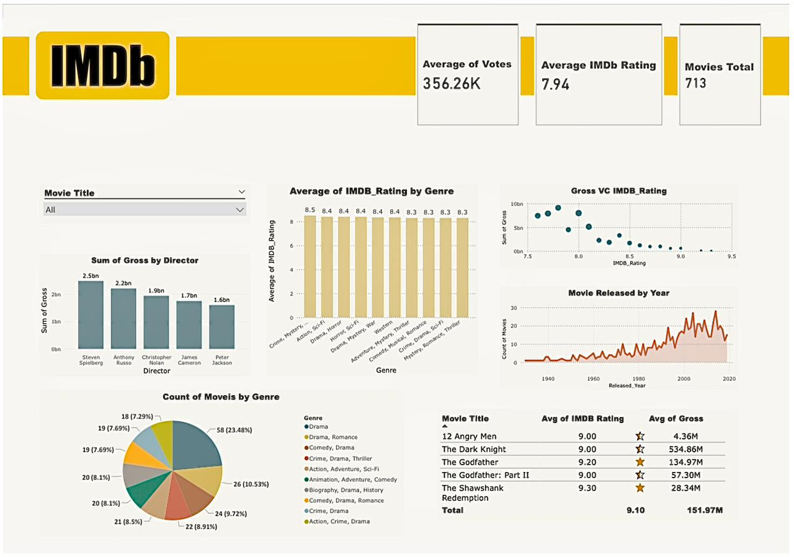
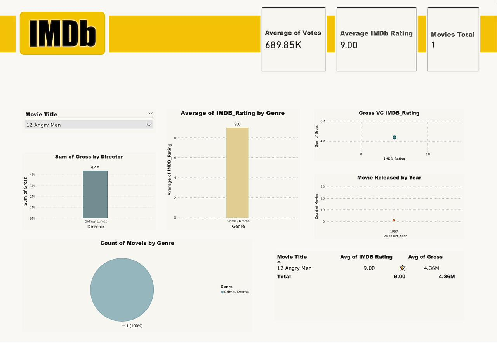

#Power BI Dashboard - IMDb Data Analysis

## Project Overview
An interactive dashboard built with *Power BI* to analyze movies data from *IMDb*.  

The goal of this project is to transform raw data into clear visual insights that highlight key performance indicators and trends in the film industry.

## Key Insights
- Number of movies, average ratings, average votes, and total revenue.  
- Comparison of ratings by movie genre.  
- ⁠Top directors ranked by revenue.  
- Movie release trends over the years.  
- A summary table of top movies with ratings and revenues.  

## Screenshots
  
  

##  How to Open
- Open the file imdb_dashboard.pbix using *Power BI Desktop*.  

##  Repository Contents
- imdb_dashboard.pbix → The Power BI dashboard file.  
- scs1.jpg, scs2.jpg → Dashboard screenshots.  
- README.md → Project description.  

## 👤 About Me
This project is part of my *Data Analytics portfolio with Power BI*.  

Feel free to connect with me on LinkedIn: [https://www.linkedin.com/in/rahaf-al-zhrani77?utm_source=share&utm_campaign=share_via&utm_content=profile&utm_medium=ios_app].
